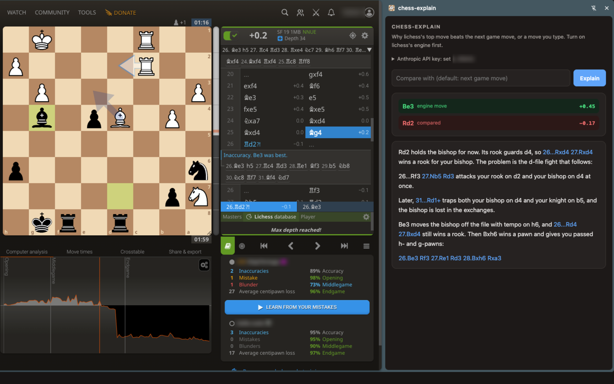
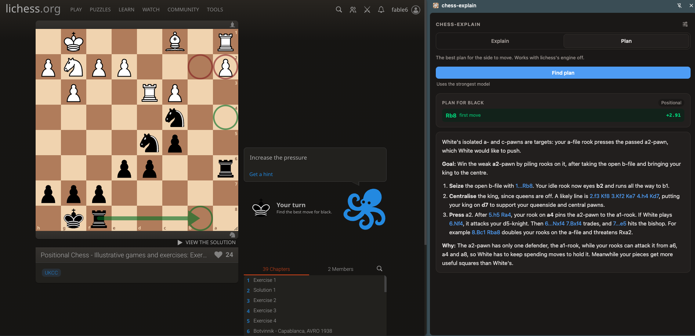

<div align="center">

  

  <h3>chess-explain</h3>

  Lichess tells you your move was a blunder. chess-explain tells you why.
  <br>
  <strong>[Install from the Chrome Web Store][store-link]</strong>
  <br>
  <br>
  [Report a bad explanation][issues-link]
  ·
  [Privacy][privacy-link]
  ·
  [Support on Ko-fi][kofi-link]
  <br>
  <br>
  [![Test][test-badge]][test-link]
  [![Release][release-badge]][release-link]
  [![Chrome Web Store][store-badge]][store-link]
  [![License][license-badge]][license-link]

</div>

## Overview

chess-explain is a free and open source Chrome side panel that explains why lichess's engine move is
better than the one you played, so next time you can blunder in a new and more interesting way.



You know the feeling. The engine bar drops off a cliff, lichess says *"Blunder. Qd6 was best."*, and
you stare at Qd6 for a while. It looks like a perfectly ordinary queen move. Stockfish knows why it's
better. Stockfish is not telling.

chess-explain makes it talk. It runs Stockfish in your browser, collects the hard facts (what each move
threatens, what it leaves hanging, how the evaluation moves after every reply), and asks Claude to turn
them into a few sentences a human can use.

There is no server of ours anywhere: the engines run on your machine, and the only calls leave your
browser for Anthropic (the explanation) and lichess (the fair-play check).

## How it works

1. The side panel reads the position, lichess's top engine move, and the next game move from the
   lichess analysis board you have open.
2. **Stockfish 19** (the WebAssembly "lite" build, one copy per move, so both lines are searched at
   once) analyses both moves: the evaluation after every move of each line, captures, checks, new
   attacks, pins, trapped pieces, and what the opponent threatens (a null-move search: "what would you
   do if I passed?"). When the better move is a quiet one that sets up
   a capture, it also plays that capture right away, and the follow-up the capture is for, to show why
   it has to wait.
3. **Stockfish 15's classical evaluation terms** (mobility, king safety, pawn structure, ...) are
   compared a few moves into each line, for the positional part of the answer. Modern Stockfish
   evaluates with a neural network, which is brilliant and completely unable to explain itself, so the
   old hand-written terms are brought back to do the explaining. They are rescaled to match Stockfish
   15.1's values.
4. **Claude** (Opus 5.5, or Fable 5.2 if you pick it in the settings) turns that fact sheet into a short explanation. The prompt forbids it from
   inventing moves or squares that are not in the facts. Chess commentary is a field with a long
   tradition of confident nonsense; we try not to add to it.

In a game or study, the coach remembers the reasons it gave for the last few moves of that line (kept in this browser
profile only) and does not repeat them unless they decide the move.

When both moves are within 0.3 pawns, it says so and skips the rest of the analysis and the LLM call. Sometimes the honest answer is
"either move is fine".

With the **Positional depth** switch on (under the Explain button, on by default), the extension first asks the model for the positional ideas behind the better
move (a weak square, a bad bishop, an open file), each backed by board checks: which piece stands where,
what it attacks, whether a pawn can ever cover a square. The extension runs every check on the board and
throws away any idea with a check that does not hold, then writes the answer with the ideas that passed.
On 39 positions from Silman's *How to Reassess Your Chess*, this took Opus from giving the book's reason in
14 of 78 answers to 34, with no clear rise in false claims.

## Find plan

Sometimes there is no blunder to explain, only a position and the question of what to do with it. The
**Plan** tab answers that for the side to move.



1. **Stockfish 19** finds the best move and its line, with the same labels as above, and what the
   opponent threatens.
2. The model proposes one to three plan ideas (a weak pawn to attack, a square for a
   knight, a file to take), each backed by board checks. The extension runs every check on the board
   and throws away any idea with a check that does not hold.
3. The same model writes the plan from the ideas that passed: a goal, two or three steps with the
   moves of the engine line that carry them out, and why it works.

The first move is drawn on the board as a green arrow, and the squares the plan aims at are circled:
red to attack, green to occupy. They are only drawn, never saved to a study.

## Fair play

Using engine help during a game you are playing is cheating, and this tool would rather not be your
accomplice. chess-explain works where lichess itself allows its engine (analysis boards, studies,
finished games), and in a study where lichess has it turned off (computer analysis disabled, or an
interactive lesson). It never works with a game in progress or in a broadcast. Before every explanation
and every plan the panel asks lichess's public API whether your account is playing a game. If you are, or if it cannot tell (logged out, network error), it refuses. Go finish
your game. It will still be a blunder afterwards, and we can talk about it then.

## Installation

You need Chrome (or another Chromium-based browser) and an
[Anthropic API key](https://console.anthropic.com/).

1. Install chess-explain from the [Chrome Web Store][store-link].
2. Click the extension's toolbar icon to open the side panel.
3. Set your API key in the panel's settings. It is stored in `chrome.storage.local` (this browser
   profile only, not synced) and sent only to the Anthropic API.

**From source:** clone this repository, open `chrome://extensions`, turn on Developer mode, click
**Load unpacked** and pick the `extension/` folder. There is no build step: everything it needs is
committed.

## Usage

Open a game or position on lichess's analysis board, step to the position where you want an
explanation, and click **Explain**. By default it compares the engine's top move with the move played
next in the game; type a move in the box to compare with that instead. With lichess's engine on, the
top move is lichess's; with it off, the extension's own Stockfish picks it. Click a move in the
answer to play its line on the board, up to that move.

For a plan instead, switch to the **Plan** tab and click **Find plan**. It needs no move to compare
with and works with lichess's engine off.

Each explanation takes about half a minute. That is three engines running dozens of searches in a
browser tab, so make a cup of tea, or use the time to guess the answer yourself.

The position, the two moves and the engine analysis are sent to Anthropic; your lichess username is
sent only to lichess, for the fair-play check. See [PRIVACY.md][privacy-link].

## Cost

You pay Anthropic for what you use. An explanation is written by Claude Opus 5.5, with effort set to high
so it thinks the facts through before it writes. With positional depth on, as it is by default, the
model is first asked for the positional ideas, so an explanation is two calls. The engines do the
heavy lifting for free on your own machine; the model only has to put a one-page fact sheet into words.

At Anthropic's prices as of October 2026 ($4 per million input tokens, $20 per million output tokens), the
call that writes the answer sends about 6,100 tokens, 4,300 of them the system prompt, and gets back about
150. The call for the positional ideas sends about 2,300 and gets back about 270. That comes to about 4
cents. The model's thinking comes on top and was not measured; each 1,000 thinking tokens adds about 2 cents
to a call. So an explanation costs about 5 to 10 cents with positional depth, and about 3 to 6 without it.

The settings also offer Claude Fable 5.2, which then makes every call. It costs twice as much per token ($8
per million input tokens, $40 per million output tokens) and takes longer. Its cost per explanation was
not measured; expect about twice the figures above.

A third setting splits the work: Fable 5.2 makes the ideas call (the positional ideas, or the plan ideas),
Opus 5.5 writes. Only the ideas call pays Fable's price. With positional depth off an explanation has no
ideas call, so this setting then equals Opus 5.5. On the command line it is
`--model claude-fable-5-2+claude-opus-5-5`.

The system prompt is cached for 5 minutes, so a second explanation within 5 minutes pays about 1.6 cents
less for its input; the first pays about 0.4 cents more to write the cache. Asking about the same move
again (the same position, the same two moves compared, the same depth, model and extension version) shows the
saved answer, for free. A plan is two calls to the model: one for the ideas, one for the text.

## Development

The extension is about 1,000 lines of plain JavaScript, with no framework and no build step.

| Path                       | What it is                                                                 |
| -------------------------- | -------------------------------------------------------------------------- |
| `extension/explain.js`     | The core: engine I/O, the fact builder and the Claude call. Runs in the side panel and in Node. |
| `extension/request.js`     | From a sheet to the answer or the plan, and the panel's requests: fair play, saved answers, the sheets built ahead. |
| `extension/features.js`    | The pawn and piece features, the one table that words them as labels, and the imbalances built from them. |
| `extension/prompt.js`      | The explainer prompt (sheet legend and rules), the concept proposer's prompt and the rule checks the eval runs on each answer. |
| `extension/concepts.js`    | The deeper read: the board checks behind each positional idea the proposer suggests, and their wording on the fact sheet. |
| `extension/panel.js`       | The side panel UI: the settings, the spinners and the rendering of a request's result. |
| `extension/lichess.js`     | The lichess board: reads the position, plays a line, draws a plan's shapes. |
| `extension/md.js`          | The small Markdown renderer and the move links in the answer.              |
| `extension/background.js`  | Shows the side panel on lichess tabs only; clears a plan's shapes when it closes. |
| `extension/vendor/`        | chessops and the two Stockfish builds, generated by `npm run vendor`.      |
| `test.js`                  | Regression tests.                                                          |
| `test-engines.json`        | The engine replies test.js replays, recorded with `node test.js --record`. |
| `eval.js`                  | The eval runner for positional explanations.                               |
| `eval-sets/quiet-132.json` | The 132-position eval set it runs by default.                              |

All commands below need [Node.js](https://nodejs.org/) 24.2 or newer.

### Command line

`explain.js` also runs without the extension:

```sh
ANTHROPIC_API_KEY=... node extension/explain.js "<FEN>" <move> [--vs <move>] [--nodes <N>] [--no-llm] [--model ID] [--deep]
```

`--no-llm` prints the fact sheet the model would see, and needs no API key. It is the best way to see
what an explanation is built from. `--deep` checks positional ideas before the answer, as the **Positional depth**
switch does, and prints the sheet with them.

### Tests

```sh
node test.js            # replays the recorded engine replies: under a second
node test.js --record   # runs the real engines and, if every test passes, rewrites test-engines.json: about three minutes
```

The tests build fact sheets for a set of regression positions, with the LLM stubbed out. By default the engines
are replayed from `test-engines.json`, the replies the real engines gave to the same commands. A change that sends
the engines a command they were not recorded with fails with "not recorded": run `--record` and commit the new file.
The engines run on one thread, so they give the same lines on every run. lichess's status API is stubbed for the
fair-play check. CI runs both modes on every push to `main` and every pull request, and fails if the recording
is out of date.

### Eval set

```sh
ANTHROPIC_API_KEY=... node eval.js [out-dir] [--no-llm] [--model ID] [--deep] [--facts DIR] [--set FILE] [--summary] [--judge]
```

This explains the 132 quiet positions in `eval-sets/quiet-132.json`, from lichess games, where the better move
wins on position rather than with a tactic, and writes one fact sheet and answer per position to `out-dir` (default `eval-out/`). Run
it before and after a change and diff the two folders. `--no-llm` writes the fact sheets only.
`--model ID` picks the Claude model (default Opus 5.5). `--deep` checks positional ideas before each answer, as the
**Positional depth** switch does, and tells the judge what the checked ideas on a sheet mean; to compare a deep run
with a plain one, judge both with `--deep`. `--facts DIR` reuses the fact sheets in `DIR`
instead of running the engines, so a prompt or model change takes a minute or two instead of half an hour.
`out-dir/summary.txt` lists the rule checks each answer fails: over 120 words, raw labels, a space after a move
number, a check or move that is not in the fact sheet, story words, evals or other numbers, naming the engine, and a
"Next time:" line that is not last or runs over 15 words. `--summary` re-checks
an existing `out-dir` without a run. `--judge` also has Claude Opus grade each answer against its fact sheet:
whether it finds the decisive point, which of its claims the facts do not support, and whether it invents a
cause for a term difference. The judge gets the sheet legend but not the rules, so a rule change under test does not
bias it. A verdict costs about 4 cents and is kept in `out-dir/<name>.judge.json`, so a
second `--judge` only grades new answers. `--set FILE` runs a JSON list of `{id, fen, played, better}` instead
of `eval-sets/quiet-132.json`; an entry with a `reference_reason` (a strong player's reason) also has the judge
say whether the answer gives that reason. A position where the two moves are within 0.3 pawns gets the panel's
plain "about as good" verdict, no LLM call, and is left out of the checks and the judge totals. Each run prints the judge totals, the median answer length and how
many answers go over 120 words.

```sh
node eval.js --print explainer|judge|pair [--model ID] [--set FILE] [--deep]
```

prints that prompt exactly and exits: the explainer prompt for `--model` (default Opus 5.5), or a judge prompt with the
JSON schema its verdict must match. Use it to run the explainer and judge as Claude Code subagents instead of through
the API.

```sh
node eval.js --sample N --month YYYY-MM
```

draws N fresh positions from that month's [lichess database](https://database.lichess.org) (rapid and
classical games, both players 1600-2200, the same quiet screen as the eval set) into
`eval-sets/holdout-YYYY-MM.json`, for `--set`. It needs the `zstd` command and reads only the start of the
file. Use these positions to measure a change, never to design one. `--masked` writes
`out-dir/<name>.masked.txt` per answer with both candidate moves hidden; a reader saves which move the text
argues for in `<name>.masked.json` (`{"better": "<SAN>"}`), and the summary counts how often that is the
better move.

### Updating the bundled libraries

`extension/vendor/` is committed, so the extension works straight from a clone. To rebuild it after
changing the versions in `package.json`:

```sh
npm install
npm run vendor
```

### Releasing

Set `version` in `extension/manifest.json`, commit, then tag and push:

```sh
git tag v<version> && git push origin v<version>
```

The release workflow checks that the tag matches the manifest and attaches `chess-explain.zip` to a
GitHub release. `npm run zip` builds the same zip locally, for the Chrome Web Store.

## Contributing

Issues and pull requests are welcome, and so are bad explanations: if chess-explain tells you something
wrong about a position, [open an issue][issues-link] with the FEN and the two moves. A good bad example
can become a regression test.

Some things that would make it better:

- **Smarter labels.** Attacks are labelled only when they are direct. Pins are labelled, skewers are
  not, and batteries and discovered attacks show up only through the "threatens" labels.
- **Other browsers.** Firefox has no side panel API, so it needs a port to its sidebar.

## Limitations

- The lite Stockfish build uses a small network: far stronger than any human, weaker than full
  Stockfish.
- Standard chess only. Your Crazyhouse blunders remain a mystery.
- The answer explains the engine line and the structure it leaves; the deeper positional reason a strong
  player would give (what a move keeps guarded, what a manoeuvre aims at) is often not in the engine
  facts at all. Letting the model query the engine itself was tested and did not change that.

## Support

chess-explain is free and stays free. If it explained one of your blunders well enough that you made a
different one next time, you can [buy me a coffee on Ko-fi][kofi-link].

## License and acknowledgements

chess-explain is free software, licensed under the GNU General Public License v3.0 or later. See
[LICENSE][license-link].

It stands on the shoulders of people who gave their work away:
[Stockfish](https://stockfishchess.org/) (GPL-3.0) and its many contributors, the WebAssembly builds
from [stockfish.js](https://github.com/nmrugg/stockfish.js), lichess's
[chessops](https://github.com/niklasf/chessops) (GPL-3.0-or-later), and
[lichess.org](https://lichess.org/) itself, free and open source and the reason any of this is fun.

[store-link]:     https://chromewebstore.google.com/detail/chess-explain/bjdphipaglklkipdgnafphplndgplipc
[store-badge]:    https://img.shields.io/chrome-web-store/v/bjdphipaglklkipdgnafphplndgplipc?style=for-the-badge&label=chrome%20web%20store
[test-link]:      https://github.com/anavalo/chess-explain/actions/workflows/test.yml
[test-badge]:     https://img.shields.io/github/actions/workflow/status/anavalo/chess-explain/test.yml?branch=main&style=for-the-badge&label=tests
[release-link]:   https://github.com/anavalo/chess-explain/releases/latest
[release-badge]:  https://img.shields.io/github/v/release/anavalo/chess-explain?style=for-the-badge&label=release
[license-link]:   LICENSE
[license-badge]:  https://img.shields.io/github/license/anavalo/chess-explain?style=for-the-badge
[issues-link]:    https://github.com/anavalo/chess-explain/issues
[privacy-link]:   PRIVACY.md
[kofi-link]:      https://ko-fi.com/anavalo
