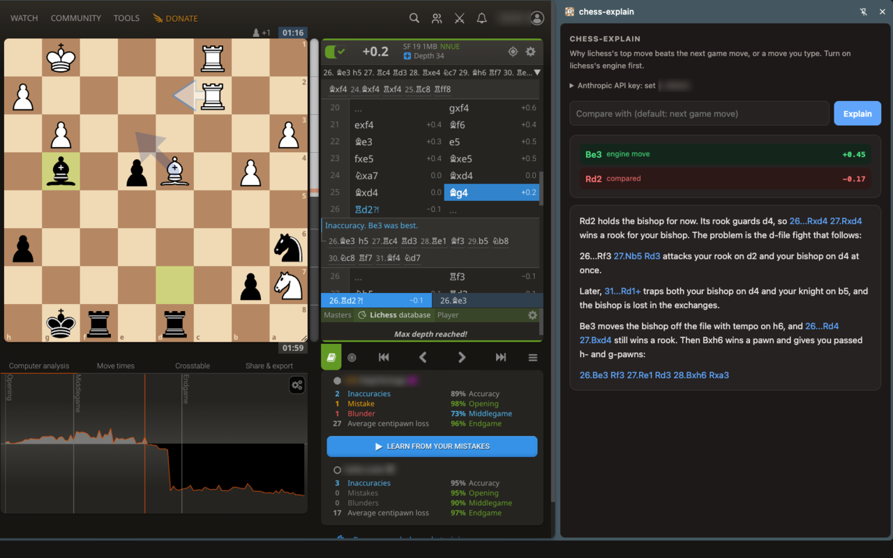

# chess-explain

**Lichess tells you your move was a blunder. chess-explain tells you why, so next time you can blunder
in a new and more interesting way.**



You know the feeling. The engine bar drops off a cliff, lichess says *"Blunder. Qd6 was best."*, and you
stare at Qd6 for a while. It looks like a perfectly ordinary queen move. Stockfish knows why it's
better. Stockfish is not telling.

chess-explain is a Chrome side panel that makes it talk. It runs Stockfish in your browser, collects
the hard facts (what each move threatens, what it leaves hanging, how the evaluation moves after every
reply), and asks Claude to turn them into a few sentences a human can use.

Free, open source, and no server of ours anywhere: the engines run on your machine.

**[Install chess-explain from the Chrome Web Store](https://chromewebstore.google.com/detail/chess-explain/bjdphipaglklkipdgnafphplndgplipc)**

## How it works

1. The side panel reads the position, lichess's top engine move, and the next game move from the
   lichess analysis board you have open.
2. Stockfish 19 (the WebAssembly "lite" build, running in the panel) analyses both moves: evaluation
   after every move of each line, captures, checks, new attacks, trapped pieces, and what the opponent
   threatens (a null-move search: "what would you do if I passed?").
3. Stockfish 15's classical evaluation terms (mobility, king safety, pawn structure, ...) are compared
   a few moves into each line, for the positional part of the answer. Modern Stockfish evaluates with a
   neural network, which is brilliant and completely unable to explain itself, so the old hand-written
   terms are brought back to do the explaining. They are rescaled to match Stockfish 15.1's values.
4. Claude Haiku turns that fact sheet into a short explanation. The prompt forbids it from inventing
   moves or squares that are not in the facts. Chess commentary is a field with a long tradition of
   confident nonsense; we try not to add to it.

When both moves are within 0.3 pawns, it says so and skips the LLM call. Sometimes the honest answer
is "either move is fine".

## Fair play

Using engine help during a game you are playing is cheating, and this tool would rather not be your
accomplice. chess-explain only works where lichess itself shows its engine (analysis boards, studies,
finished games), and before every explanation the panel asks lichess's public API whether your account
is playing a game. If you are, or if it cannot tell (logged out, network error), it refuses. Go finish
your game. It will still be a blunder afterwards, and we can talk about it then.

## Install

You need Chrome (or another Chromium-based browser) and an
[Anthropic API key](https://console.anthropic.com/). You pay Anthropic for what you use, and it is not
much: an explanation is one call to Claude Haiku 5.5, Anthropic's smallest and cheapest model, with
effort set to high so it thinks the facts through before it writes. The engines do the heavy lifting
for free on your own machine; the model only has to put a one-page fact sheet into words.

In numbers (Anthropic's prices as of October 2026): Haiku 5.5 costs $0.10 per million input tokens and
$0.50 per million output tokens. An explanation sends about 3,000 tokens and gets back a short answer
plus the model's thinking, which comes to a fraction of a cent. Even if the model used its whole
16,000-token output limit, one explanation would cost less than one cent.

1. Install chess-explain from the
   [Chrome Web Store](https://chromewebstore.google.com/detail/chess-explain/bjdphipaglklkipdgnafphplndgplipc).
2. Click the extension's toolbar icon to open the side panel.
3. Set your API key in the panel's settings. It is stored in `chrome.storage.local` (this browser
   profile only, not synced) and sent only to the Anthropic API.

**From source:** clone this repository, open `chrome://extensions`, turn on Developer mode, click
**Load unpacked** and pick the `extension/` folder. No build step: everything it needs is committed.

## Use

Open a game or position on lichess's analysis board, turn on lichess's engine, step to the position
where you want an explanation, and click **Explain**. By default it compares lichess's top move with the
move played next in the game; type a move in the box to compare with that instead.

Each explanation takes about 15–25 seconds. That is two engines running dozens of searches in a
browser tab, so make a cup of tea, or use the time to guess the answer yourself. The position, the
engine lines and their evaluations are sent to Anthropic; your lichess username is sent only to
lichess, for the fair-play check. See [PRIVACY.md](PRIVACY.md).

## Hacking on it

The whole thing is about 800 lines of plain JavaScript, with no framework and no build step for
the extension itself.

- `extension/explain.js`: the core. Engine I/O, the fact builder, the prompt and the Claude call.
  The same file runs in the side panel and in Node.
- `extension/panel.js`: the side panel UI, which reads the lichess board and renders the answer.
- `test.js`: the tests.
- `extension/vendor/`: generated by `npm run vendor` (chessops and the two Stockfish builds).

### Command line

The same code runs in [Node.js](https://nodejs.org/) (Node 24.2 or newer), without the extension:

```sh
ANTHROPIC_API_KEY=... node extension/explain.js "<FEN>" <move> [--vs <move>] [--effort low|medium|high] [--no-llm]
```

`--no-llm` prints the fact sheet the model would see, and needs no API key. It is the best way to see
what the explanation is built from.

### Tests

```sh
node test.js
```

This runs the real engines (single-threaded, so results are repeatable) on a set of regression
positions, with the LLM stubbed out. It calls lichess for
the fair-play check and takes about three minutes.

### Eval set

```sh
ANTHROPIC_API_KEY=... node eval.js [out-dir] [--no-llm]
```

This explains 30 quiet positions from lichess games, where the better move wins on position rather than
with a tactic, and writes one fact sheet and answer per position to `out-dir` (default `eval-out/`).
The engines give the same lines on every run, so run it before and after a change and diff the two
folders. `--no-llm` writes the fact sheets only.

### Updating the bundled libraries

`extension/vendor/` is committed, so the extension works straight from a clone. To rebuild it after
changing the versions in `package.json`:

```sh
npm install
npm run vendor
```

`npm run zip` packages `extension/` as `chess-explain.zip` for the Chrome Web Store.

To release, set `version` in `extension/manifest.json`, commit, then tag and push (`git tag v0.2 && git push
origin v0.2`). The release workflow checks the tag matches the manifest and attaches the zip to a GitHub
release.

## Contributing

Issues and pull requests are welcome, and so are bad explanations: if chess-explain tells you
something wrong about a position, [open an issue](https://github.com/anavalo/chess-explain/issues)
with the FEN and the two moves. A good bad example can become a regression test.

Some things that would make it better:

- **Speed.** Analysis in Chrome is about 3x slower than the same analysis in Node. Nobody has profiled
  why yet.
- **Smarter labels.** Attacks are labelled only when they are direct. Pins are labelled, skewers are
  not, and batteries and discovered attacks show up only through the "threatens" labels.
- **Other browsers.** Firefox has no side panel API, so it needs a port to its sidebar.

## Limitations

- Engine lines are not deterministic, so the same position can get a slightly different explanation.
- The lite Stockfish build uses a small network: far stronger than any human, weaker than full
  Stockfish.
- Standard chess only. Your Crazyhouse blunders remain a mystery.

## License and thanks

GPL-3.0-or-later. See [LICENSE](LICENSE).

chess-explain stands on the shoulders of people who gave their work away:
[Stockfish](https://stockfishchess.org/) (GPL-3.0) and its many contributors, the WebAssembly builds
from [stockfish.js](https://github.com/nmrugg/stockfish.js), lichess's
[chessops](https://github.com/niklasf/chessops) (GPL-3.0-or-later), and
[lichess.org](https://lichess.org/) itself, free and open source and the reason any of this is fun.
